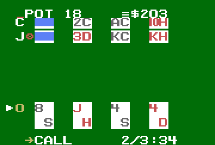
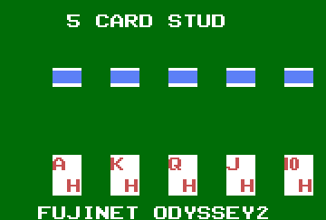
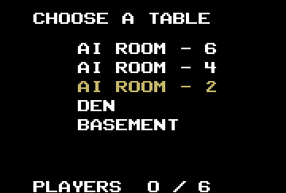
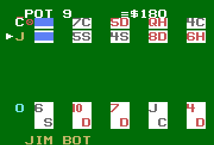
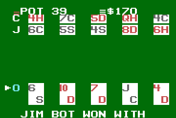
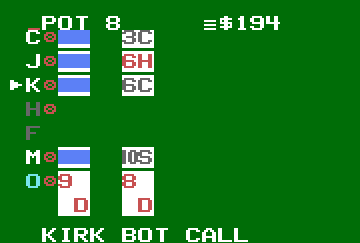
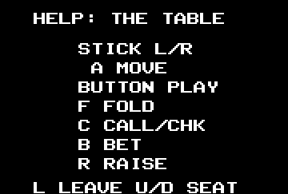

# 5 Card Stud for the Odyssey 2

5 Card Stud for the Magnavox Odyssey 2 / Philips Videopac, over the FujiNet
O2 cartridge. It plays the same server as every other client: up to eight
seats, bots at the AI tables.

It is 8048 assembly (Macroassembler AS), built as a **protocol 2 (APPBANK)**
image: the fixed 1K at `$400-$7FF` holds the display engine, and seven 2K
pages at `$800` hold everything else. It needs firmware with APPBANK
(fujinet-firmware PR #2177).

Only tested in MAME (`-cartslot fujinet`), never on a real console.

## Playing

| Where | Stick | Button | Keys |
|---|---|---|---|
| Name (first run) | | | letters, digits, space; CLR rubs out, ENT ends |
| Tables | up/down | sit down | |
| Your move | left/right picks | plays it | F fold, C check or call, B bet, R raise, P post |
| Anywhere at the table | up/down: the spotlight | | L leaves |
| Anywhere but the name | | | H or ? shows the help; any key or the button goes back |

The name is FujiNet's shared one (appkey creator 1, app 1, key 0).

## The screen



The whole table is one screen. Up to six opponents sit in rows, each a
letter and their cards; your hand is at the bottom, two rows tall. The
cards are the VDC's grid in fill mode, white on green felt, with the rank
and suit over them: red for hearts and diamonds, near-black for spades and
clubs, a blue block for a card face down. T0 at the top has the pot and your
purse. T1 at the bottom is your move menu and its clock on your turn,
otherwise the seat in the spotlight (whose turn it is, or the one you
picked) and what it did last, and between hands the result.

A seat's letter is tan when it is to move, grey when it has folded or is
out, cyan for you. The four sprites are the chips and the spotlight: an
arrow left of the seat in the spotlight, a chip between a seat's letter and
its cards while it has a bet in this street, and in T0 a stack of chips by
the pot and by your purse, one to four high (from 1, 25, 100, 250). At an
eight-seat table one opponent is off the screen; the rows scroll to follow
the spotlight.

### Screenshots

From MAME, against a private server:

| | | |
|---|---|---|
|  |  |  |
| The title | Your name, the first time | The tables |
|  |  |  |
| Your move: call, 2 of 3, 34 seconds; J has bet | Jim to move; Clyd has bet | The showdown: every hand up |
|  |  | |
| Eight seats: Kirk called | Help (H or ?) | |

### How it's drawn

`src/fixed.inc` re-points the 12 single characters between rows from a
line-counter interrupt: Battleship's engine, which was M.U.L.E.'s. Every
screen is T0 (the four quads, written in the vblank), eight rows of 11
singles at Y 30 + 24r (one per grid row), and T1 (the quads again). A text
screen is the same rows on black, the singles side by side.

What fits, measured in MAME (`make spike`, `make shot`):

- **A row is 11 characters.** A band writes Y, pointer and control, 15
  cycles a character, in the 10 lines between two rows, then sprite 1's Y;
  that leaves 6-9 cycles spare (`PADN` 2 holds, 4 cuts). So a seat's name
  is one letter: two would need 15 cycles and 28 bytes of the fixed half,
  which has neither.
- **The chips are one sprite.** Each row's table ends with sprite 1's Y,
  its chip's or below the screen, and the band that writes the row writes
  it too: 5 cycles, and the sprite is down a row each band. The arrow and
  the two stacks stay where the vblank puts them. A sprite shows only while
  the foreground is on, so each one sits inside a row's 14 lines, or T0's.
- **The gap between two rows of cards** is the grid switched off for 3 lines
  across the grid's row boundary, from inside the row write (`SEPA`,
  `SEPB`). Each write is placed after a chosen register so that it lands in
  the horizontal blank: mid-line, the line it splits jitters by the
  interrupt's latency. `tools/rowcheck.py` finds no frame that differs.
- **The counter is re-armed first in each band.** Re-armed after the write,
  the read-add-write of T can straddle a line's count and lose it, and every
  band after it is a line later each frame.
- Row 0 and the grid are written at line 1 (`h_top`); the vblank has only T0
  and the sprites; row 0 is staged by the band before (T1).

## Building

```
make                                  # build/5card.bin, the live server
make ENDPOINT=http://localhost:8087/  # another server
make spike                            # the engine's test pattern
make run                              # MAME, in a window (run.sh)
```

The build needs `~/asl/asl` and `p2bin` (`ASL=`, `P2BIN=`). After assembling
each page, `build.sh` runs Battleship's checks, each for a fault that is
silent at run time: `checkflags` (a JZ testing a MOV), `checkobj` and
`checklayout` (overlaps), `checkmb` (a cross-bank call with no restore),
`checkpage` (a MOVP table outside the page the MOVP runs in), `checkstack`
(the 8-level stack). It also checks the fixed half is the same in every page.
`tools/pageends.py` shows how full each page's sections are.

### Pages

| Page | |
|---|---|
| 0 | boot: cart check, name from the appkey, the table list, join |
| 1 | the network: CLOSE, OPEN, STATUS until settled, READ; one step a frame |
| 2 | the main loop: keys, stick, polls, dispatch |
| 3 | a state: the header, our moves, the spotlight's arrow, the rows that changed; the title |
| 4 | every frame: the move menu, the clock, the spotlight, the result's pages |
| 5 | help, and name entry |
| 6 | a state, after page 3: T0 and its stacks, T1, the sounds, the chips |

A state is taken only if its length is `154 + 33n`, and the table list only
if it is `1 + 36n`.

## Testing

Everything runs headless in MAME through `tools/o2sim.py`. `test/rig.sh`
builds and starts the server from `~/Workspace/servers/fujinet-game-system/
5cardstud/server` on port 8087 and a private fujinet-pc-rs232 on BoIP 19972,
with the name appkey seeded; it refuses an image not built for it.

```
make shot      # the spike: snapshots + tools/rowcheck.py
make test      # boot, the table, help, leaving, name entry
make soak      # an AUTOPLAY build plays the AI table with two bots
make eight     # ... the hidden dev7 table: eight seats, the rows scroll
make two       # ... against test/player.py at The Basement: two humans
```

What has run, all in MAME against the private server: boot, name entry,
the table list, join, help, leave; AUTOPLAY hands at `ai2` to showdown and
on, every request a 200; eight seats and the scroll; three hands against a
second human; `rowcheck` steady while the game runs; the sounds
(`O2SIM_WAV`, `tools/sndcheck.py`).

## Not done

- **Lobby handoff (appkey key 5).** There is no O2 lobby.
- **PAL.** The band timing is NTSC's.
- **Real hardware.** T0 at line 16, T1 at line 228 and the spotlight's
  arrow at the left edge may sit in a TV's overscan.
